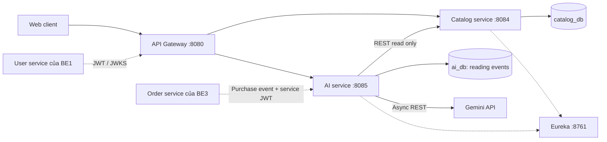

# BookApplication - Catalog và AI microservices


## Kiến trúc và phạm vi



- Catalog sở hữu các bảng `books`, `categories`, `authors`, `publishers`, `books_authors`.
  Book liên kết một thể loại, một nhà xuất bản, nhiều tác giả có thứ tự.
- AI chỉ đọc catalog qua REST, không truy cập trực tiếp catalog_db. AI lưu lịch sử
  VIEW/FAVORITE/PURCHASE trong ai_db, không lưu nội dung hội thoại.
- Tồn kho thuộc inventory-service theo ảnh phân công. API catalog không nhận hay sửa
  stockQuantity. Frontend/order-service cần kết hợp thông tin tồn kho từ BE3.
- Xóa sách là ẩn sách (`active=false`) để bảo toàn mã đã được dịch vụ khác tham chiếu.
  Sách đã ẩn không xuất hiện trong API đọc/tìm kiếm/AI. Danh mục, tác giả và nhà xuất bản
  còn được sách (kể cả sách ẩn) tham chiếu không thể xóa.
- Các module cũ được giữ nguyên; gateway vẫn giữ `/books/**` và `/orders/**`.
  API mới dùng `/api/catalog/**`, `/api/ai/**`. Hai API sách cũ/mới có dữ liệu độc lập;
  frontend mới cần chuyển sang catalog. Không tự sao chép hoặc xóa dữ liệu cũ.
- PostgreSQL có database/user riêng cho từng service. Flyway tạo schema có khóa ngoại,
  unique/check constraints; Hibernate chỉ validate, không tự sửa schema.
- AI đăng ký Eureka để gateway định tuyến. Kết nối AI -> Catalog dùng địa chỉ
  `CATALOG_URL` cấu hình được, phù hợp DNS nội bộ hoặc địa chỉ service khi triển khai.

## Ranh giới service và tổ chức mã

Không ánh xạ một bảng thành một microservice. Book, Category, Author và Publisher
cùng thuộc nghiệp vụ danh mục sách; các phép liên kết, tìm kiếm và kiểm tra tham
chiếu được thực hiện trong một giao dịch/database của catalog.
`books_authors` là bảng liên kết nhiều-nhiều do Book quản lý, không có vòng đời
nghiệp vụ độc lập để cần một microservice riêng.

Các service triển khai phù hợp cho hệ thống:

| Service | Trách nhiệm |
|---|---|
| user-service | Tài khoản, xác thực, phân quyền, hồ sơ |
| catalog-service | Sách, thể loại, tác giả, nhà xuất bản, quan hệ sách-tác giả, tìm kiếm |
| inventory-service | Tồn kho, nhập/xuất, giữ chỗ và hoàn số lượng |
| order-service | Giỏ hàng, đặt hàng, trạng thái và lịch sử đơn |
| payment-service | Thanh toán, callback, retry, đối soát; có thể nằm trong order-service ở giai đoạn đầu |
| ai-service | Hội thoại, tìm kiếm theo nhu cầu, đề xuất sách |

Gateway và Eureka là hạ tầng định tuyến/discovery. Chỉ nên tách Author/Publisher
thành microservice khi chúng có nghiệp vụ, nhóm phát triển hoặc nhu cầu dùng chung
độc lập. Tách sớm sẽ phải giải quyết lỗi mạng, tổng hợp dữ liệu và tính nhất quán
giữa nhiều service cho cả thao tác tạo sách đơn giản.

Trong mã Java, mỗi đối tượng danh mục có controller/service/repository riêng.
Đây là các lớp trong catalog-service, không phải các tiến trình microservice:

```text
catalog-service/src/main/java/com/example/catalog/
├── CatalogApplication.java
├── Config/
│   └── SecurityConfig.java
├── Controller/
│   ├── BookController.java
│   ├── CategoryController.java
│   ├── AuthorController.java
│   └── PublisherController.java
├── Service/
│   ├── BookService.java
│   ├── CategoryService.java
│   ├── AuthorService.java
│   └── PublisherService.java
├── Repository/
│   ├── BookRepository.java
│   ├── CategoryRepository.java
│   ├── AuthorRepository.java
│   ├── PublisherRepository.java
│   └── Specification/BookSearch.java
├── Model/
│   ├── Book.java
│   ├── Category.java
│   ├── Author.java
│   └── Publisher.java
├── Dto/
│   ├── BookRequest.java
│   ├── BookResponse.java
│   ├── MetadataRequest.java
│   ├── MetadataResponse.java
│   └── PageResponse.java
└── Exception/
    └── ApiExceptionHandler.java

ai-service/src/main/java/com/example/ai/
├── AiApplication.java
├── Config/              # SecurityConfig
├── Controller/          # AiController
├── Service/             # AdviceService, HistoryService, RequestLimits
├── Repository/          # ReadingEventRepository
├── Model/               # ReadingEvent
├── Dto/                 # Request/response, dữ liệu catalog, kết quả AI
├── Client/              # CatalogClient
├── Provider/            # AiProvider, GeminiProvider
└── Exception/           # ApiExceptionHandler
```

Tên thư mục/package viết hoa đầu từ để đồng nhất với book-service hiện có.
Test tích hợp nằm trong `src/test/java/.../Integration`; unit/HTTP-client test đặt
theo package Service, Client, Provider tương ứng. Migration nằm trong
`src/main/resources/db/migration`, cấu hình test trong `src/test/resources`.

`MetadataRequest/MetadataResponse` dùng chung cho ba loại danh mục để giữ hợp đồng
API hiện tại; xử lý nghiệp vụ đã tách thành ba service, không dùng switch theo
`kind` trong một MetadataService chung.

Các module book/category/author/publisher cũ được giữ để bảo toàn mã và dữ liệu.
Kiến trúc đích dùng catalog làm nguồn dữ liệu danh mục duy nhất; việc hợp nhất dữ
liệu cũ cần được thực hiện riêng, không chạy hai nguồn danh mục như thể đã đồng bộ.

## Môi trường và build

Yêu cầu JDK 21, PostgreSQL hoặc Docker Compose. Các module dùng Spring Boot 4.1.1,
Spring Cloud 2025.1.3, Maven Wrapper 3.9.16, JUnit Jupiter.
Không có POM tổng ở thư mục gốc. Chạy PowerShell từ thư mục dự án:

```powershell
# Đặt JAVA_HOME trỏ đến JDK 21 đã cài trên máy.
$env:JAVA_HOME = 'C:/Program Files/Java/jdk-21.0.12.1'

Push-Location catalog-service
.\mvnw.cmd clean verify
Pop-Location

Push-Location ai-service
.\mvnw.cmd clean verify
Pop-Location
```

Test dùng H2 ở chế độ PostgreSQL và máy chủ HTTP giả lập trên loopback; không cần
database ngoài, Eureka, JWT thật hay khóa Gemini. Môi trường test phải cho phép
kết nối loopback. Mockito được nạp bằng javaagent trong Surefire để tránh cơ chế
self-attach bị treo/chặn trên Windows. Không đặt thêm ngưỡng coverage cho dự án.

## Chạy local

1. Cung cấp mật khẩu database trong môi trường của terminal chạy Compose:

```powershell
$env:CATALOG_DB_PASSWORD = Read-Host 'Mật khẩu catalog database' -MaskInput
$env:AI_DB_PASSWORD = Read-Host 'Mật khẩu AI database' -MaskInput
docker compose -f compose.catalog-ai.yaml up -d --wait
```

`Read-Host -MaskInput` cần PowerShell 7.1+. Với Windows PowerShell 5.1, đặt biến
môi trường bằng cơ chế quản lý secret của bạn. Không ghi khóa/mật khẩu vào Git.
Compose chỉ tạo hai database mới ở cổng 5433/5434, không sửa database cũ cổng 5432.
Mật khẩu chỉ được PostgreSQL áp dụng khi volume khởi tạo lần đầu.

2. Mở terminal riêng cho Eureka, gateway và từng service; chạy `mvnw.cmd spring-boot:run`
trong đúng thư mục. Thiết lập JAVA_HOME ở mỗi terminal nếu chưa cấu hình toàn máy.

```powershell
Set-Location F:/JavaProject/BookApplication/eureka-server
.\mvnw.cmd spring-boot:run

# Terminal khác
Set-Location F:/JavaProject/BookApplication/api-gateway
.\mvnw.cmd spring-boot:run

# Terminal catalog-service
Set-Location F:/JavaProject/BookApplication/catalog-service
$env:CATALOG_DB_PASSWORD = Read-Host 'Mật khẩu catalog database' -MaskInput
$env:JWT_ISSUER = 'http://localhost:8083'
$env:JWT_JWK_SET_URI = 'http://localhost:8083/.well-known/jwks.json'
$env:JWT_AUDIENCE = 'bookstore'
.\mvnw.cmd spring-boot:run

# Terminal ai-service
Set-Location F:/JavaProject/BookApplication/ai-service
$env:AI_DB_PASSWORD = Read-Host 'Mật khẩu AI database' -MaskInput
$env:JWT_ISSUER = 'http://localhost:8083'
$env:JWT_JWK_SET_URI = 'http://localhost:8083/.well-known/jwks.json'
$env:JWT_AUDIENCE = 'bookstore'
$env:GEMINI_API_KEY = Read-Host 'Gemini API key' -MaskInput
$env:GEMINI_MODEL = Read-Host 'Model Gemini hỗ trợ generateContent và structured output'
.\mvnw.cmd spring-boot:run
```

Các địa chỉ JWT trên là hợp đồng mặc định để BE1 tích hợp, không phải user-service
đã có sẵn trong workspace. Thay bằng issuer/JWKS thật. Không có tài khoản admin
mặc định hoặc cơ chế bỏ qua xác thực.

Để chạy trực tiếp hai service khi không dùng Eureka, đặt `EUREKA_ENABLED=false`.
Health: `http://localhost:8084/actuator/health`, `http://localhost:8085/actuator/health`.
Health kiểm tra ứng dụng/database; không xác nhận Gemini đã có khóa/model hợp lệ.

| Biến | Mặc định / ý nghĩa |
|---|---|
| CATALOG_DB_URL | jdbc:postgresql://localhost:5433/catalog_db |
| CATALOG_DB_USER / CATALOG_DB_PASSWORD | catalog / phải cung cấp mật khẩu |
| AI_DB_URL | jdbc:postgresql://localhost:5434/ai_db |
| AI_DB_USER / AI_DB_PASSWORD | ai / phải cung cấp mật khẩu |
| PORT | 8084 ở catalog, 8085 ở AI |
| EUREKA_URL | http://localhost:8761/eureka/ |
| EUREKA_ENABLED | true |
| CATALOG_URL | http://localhost:8084 |
| JWT_ISSUER / JWT_JWK_SET_URI / JWT_AUDIENCE | Xác thực JWT từ BE1 |
| GEMINI_API_KEY / GEMINI_MODEL | Bắt buộc để có kết quả AI thực; không có giá trị bí mật mặc định |

Sau build, có thể tạo image bằng `docker build -t catalog-service ./catalog-service`
và `docker build -t ai-service ./ai-service`. Dockerfile chạy bằng user không phải root.
Khi chạy trong container, truyền URL database/catalog/Eureka/JWKS theo DNS mạng container,
không dùng localhost của máy chủ.

## Swagger UI / OpenAPI

Khởi động từng service với database và biến môi trường như phần Chạy local,
sau đó mở Swagger trực tiếp (không cần Eureka hoặc gateway):

| Service | Swagger UI | OpenAPI JSON |
|---|---|---|
| Catalog | http://localhost:8084/swagger-ui/index.html | http://localhost:8084/v3/api-docs |
| AI | http://localhost:8085/swagger-ui/index.html | http://localhost:8085/v3/api-docs |

Nếu đổi PORT, thay cổng trong các URL trên. Springdoc 3.1.1 được dùng cho Spring Boot 4.
Swagger lấy request/response schema từ controller và DTO hiện có.
Trong Swagger, chọn endpoint → Try it out → nhập dữ liệu → Execute.
Đọc catalog không cần token. Với thao tác ghi catalog, nhấn Authorize và dán JWT
có role ADMIN; với API AI, dùng JWT người dùng hợp lệ. Chỉ dán token, không thêm
tiền tố Bearer vì Swagger tự thêm. Swagger không cấp token hay bỏ qua phân quyền,
và không lưu token qua lần tải lại trang.

Tài liệu AI chỉ bao gồm /api/ai/**; endpoint nội bộ /internal/ai/purchases không
xuất hiện trên Swagger và vẫn yêu cầu scope ai.history.write.
Các trang tài liệu được mở công khai khi bật Swagger. Đặt SWAGGER_ENABLED=false
trong môi trường của mỗi service để tắt cả UI và OpenAPI khi triển khai,
rồi khởi động lại service. Nếu dùng .env, IntelliJ hoặc công cụ chạy phải nạp file đó.
Swagger hiện chưa được tổng hợp tại gateway cổng 8080.

## Hợp đồng xác thực

- Bearer JWT ký RS256, kiểm tra chữ ký qua JWKS, issuer, audience, thời hạn và subject.
- Claim `sub`: mã người dùng ổn định, không rỗng, tối đa 200 ký tự.
- Claim `roles`: mảng `["ADMIN"]`, `["STAFF"]` hoặc `["CUSTOMER"]`,
  không thêm tiền tố ROLE_ vào claim. Backend ánh xạ thành ROLE_ADMIN,...
- Đọc catalog công khai; ghi catalog chỉ ADMIN. AI yêu cầu đăng nhập.
- `POST /internal/ai/purchases` yêu cầu service token có
  `scope: "ai.history.write"`. Route này không được công khai qua gateway.
- AI lấy danh tính từ JWT, không nhận userId tùy ý trên API tương tác người dùng.
- Các endpoint dùng JWT trong Authorization, không dùng cookie xác thực; CSRF được
  tắt cho API stateless. Khi frontend khác origin, cấu hình CORS ở gateway theo origin
  được phép; không mở wildcard ở từng service.

## API catalog

Base URL qua gateway: `http://localhost:8080/api/catalog`.

| Method | Path | Mô tả |
|---|---|---|
| GET | /books hoặc /search | Tìm kiếm, lọc, phân trang |
| GET | /books/{id} | Chi tiết sách |
| GET | /books/batch?ids=1,2 | Tối đa 50 ID; bỏ ID không tồn tại/đã ẩn; dùng cho service khác |
| POST | /books | Tạo sách, trả 201 + Location |
| PUT | /books/{id} | Thay toàn bộ thông tin sách |
| DELETE | /books/{id} | Ẩn sách, trả 204 |
| GET / POST | /categories, /authors, /publishers | Danh sách phân trang / tạo mới |
| GET / PUT / DELETE | /categories/{id}, /authors/{id}, /publishers/{id} | Chi tiết / cập nhật / xóa |

Query search: `q` tối đa 200 ký tự, tìm không phân biệt hoa thường theo tên sách,
mô tả, thể loại, tác giả, nhà xuất bản; `categoryId`, `authorId`, `publisherId`,
`minPrice`, `maxPrice`; `page=0`, `size=20` (1..100);
`sort=newest|title|price-asc|price-desc`. Ký tự % và _ được tìm như ký tự thường.
Tìm kiếm là substring theo từ khóa; chưa có Elasticsearch hoặc vector index.

Response phân trang:

```json
{"content": [], "page": 0, "size": 20, "totalElements": 0, "totalPages": 0}
```

Body tạo/cập nhật:

```json
{"name": "Lập trình", "description": "Sách công nghệ"}
```

Author dùng `{"name":"Tên tác giả","bio":"Tiểu sử"}`; publisher dùng `{"name":"NXB"}`.
Category/author: tên tối đa 100 ký tự; publisher: 150. Tên thể loại được trim và
so sánh không phân biệt hoa thường để chặn trùng (kèm unique constraint).

```json
{
  "title": "Java căn bản",
  "price": 150000,
  "description": "Dành cho người mới bắt đầu",
  "categoryId": 1,
  "publisherId": 1,
  "authorIds": [1, 2]
}
```

Giá >= 0, tối đa 10 chữ số phần nguyên và 2 chữ số thập phân; 1..20 tác giả,
không lặp ID. Mọi ID quan hệ phải tồn tại. Response trả `id`, `title`, `price`,
`description`, `category:{id,name}`, `publisher:{id,name}`, `authors:[{id,name}]`,
`createdAt`, `updatedAt`.

Lỗi: 400 dữ liệu không hợp lệ, 401 chưa xác thực, 403 thiếu quyền, 404 không tồn tại,
409 trùng/tham chiếu/xung đột cập nhật. Lỗi nghiệp vụ dùng ProblemDetail.

## API AI

Base URL qua gateway: `http://localhost:8080/api/ai`.

| Method | Path | Mô tả |
|---|---|---|
| POST | /chat | Hội thoại tư vấn, giải đáp thông tin sách |
| POST | /search | Xếp hạng sách theo ý định tìm kiếm |
| POST | /recommendations | Đề xuất theo nhu cầu và lịch sử tương tác/mua |
| POST | /interactions | Ghi VIEW/FAVORITE của chính người đăng nhập |
| DELETE | /interactions | Xóa lịch sử đề xuất của chính người đăng nhập |

Body cho chat/search/recommendations:

```json
{
  "message": "Tôi muốn học lập trình Java từ đầu",
  "history": [
    {"role": "USER", "content": "Tôi chưa từng học lập trình"},
    {"role": "ASSISTANT", "content": "Bạn muốn bắt đầu với ngôn ngữ nào?"}
  ],
  "limit": 5
}
```

`message`: 1..2000 ký tự; `history` tùy chọn, tối đa 10 lượt, mỗi lượt tối đa 2000 ký tự,
chỉ USER/ASSISTANT; `limit`: 1..10, mặc định 5. Frontend giữ hội thoại và gửi lại
ngữ cảnh; service không lưu transcript. Frontend phải render `answer` như text,
không render HTML trực tiếp từ mô hình.

```json
{
  "answer": "Bạn có thể bắt đầu với các sách sau...",
  "books": [],
  "degraded": false
}
```

`books` chứa thông tin thật lấy từ catalog, giữ thứ tự AI đề xuất. Quy trình:

1. Lấy tối đa 20 sự kiện gần nhất của người dùng; truy vấn sách theo câu hỏi/từ khóa
   và thể loại liên quan đến lịch sử. Tối đa 30 sách ứng viên.
2. Gửi prompt riêng biệt với dữ liệu, hội thoại và thông tin sách; không gửi JWT,
   mã người dùng, mật khẩu hay khóa API trong prompt. Mô tả mỗi sách tối đa 1000 ký tự.
3. Gọi Gemini bất đồng bộ, yêu cầu JSON `answer/bookIds`, timeout mặc định 20 giây.
4. Loại ID ngoài danh sách ứng viên, ID trùng; đọc lại catalog sau khi AI phản hồi
   để lấy giá/thông tin hiện tại và loại sách vừa bị ẩn.
5. Khi thiếu cấu hình, API AI lỗi, timeout, output sai JSON hoặc bị cắt: trả
   `degraded=true`, thông báo rõ AI không khả dụng và danh sách ứng viên tham khảo.
   Khi catalog lỗi: trả 503, không giả dữ liệu. Khi catalog rỗng: trả danh sách rỗng.

Giới hạn tư vấn: 20 yêu cầu/phút/người dùng, 8 yêu cầu đồng thời/instance; trả 429
khi vượt giới hạn. Bộ đếm trong bộ nhớ; khi chạy nhiều instance cần giới hạn phân tán
ở gateway/Redis. Đây là cơ chế truy hồi ứng viên + LLM xếp hạng, không phải mô hình
recommendation được huấn luyện hoặc tìm kiếm vector trên toàn kho sách.

Body ghi hành vi:

```json
{"bookId": 1, "type": "VIEW"}
```

BE3 gửi một sự kiện cho mỗi sách của đơn đã mua đến
`http://localhost:8085/internal/ai/purchases` bằng service JWT:

```json
{"eventId": "order-123-book-1", "userSubject": "customer-456", "bookId": 1}
```

`eventId` duy nhất (tối đa 150 ký tự); gửi lại cùng payload không tạo thêm lịch sử.
Payload khác dùng cùng eventId trả 409. Nếu hai request trùng đến đồng thời, unique
constraint có thể trả 409 cho một request; bên gửi retry cùng eventId sẽ nhận 204.
Chưa có order-service trong workspace, nên không tự đọc lịch sử mua hàng từ BE3.
Việc xóa lịch sử tương tác không xóa đơn hàng gốc.

## Ví dụ kiểm tra nhanh

```powershell
Invoke-RestMethod 'http://localhost:8084/api/catalog/books?size=10'

# Token do user-service BE1 phát hành; ADMIN để tạo catalog.
$token = Read-Host 'JWT' -MaskInput
$headers = @{ Authorization = "Bearer $token" }
Invoke-RestMethod -Method Post -Uri 'http://localhost:8080/api/ai/chat' `
  -Headers $headers -ContentType 'application/json; charset=utf-8' `
  -Body ([Text.Encoding]::UTF8.GetBytes('{"message":"Tư vấn sách Java cho người mới","limit":3}'))
```

## Tích hợp còn cần cấu hình

- BE1 cung cấp issuer/JWKS/token đúng hợp đồng; BE3 gửi sự kiện mua hàng và cung cấp
  API tồn kho; frontend tích hợp các endpoint mới.
- Cần khóa/model Gemini thật để kiểm tra chất lượng tư vấn. Test tự động không gọi
  dịch vụ AI trả phí.
- Chưa di chuyển dữ liệu từ book/category/author/publisher service cũ. Nếu cần,
  phải lập ánh xạ ID, kiểm tra quan hệ và sao lưu trước khi chuyển dữ liệu.
- H2 test chạy cùng Flyway migration nhưng không thay thế kiểm chứng PostgreSQL thực.
- Không triển khai frontend, user/order/inventory service trong phạm vi BE2.

Tài liệu kỹ thuật tham khảo:
[Spring REST clients](https://docs.spring.io/spring-framework/reference/integration/rest-clients.html),
[Gemini generateContent](https://ai.google.dev/api/generate-content).
